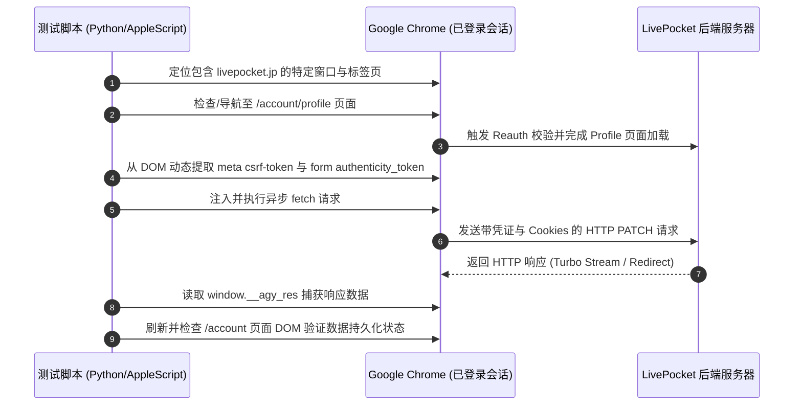

# LivePocket 账户个人信息修改接口安全与字段测试报告

## 1. 概述与测试背景

本报告记录了针对日本票务平台 **LivePocket (`livepocket.jp`)** 个人信息（Profile）修改接口的逆向分析、环境调试、执行流程及字段权限测试结果。

* **测试对象**：`POST/PATCH https://livepocket.jp/account/profile`
* **相关文件**：`request.md`
* **核心目标**：
  1. 验证 `user[last_name]`（姓氏）修改请求的发送与生效机制。
  2. 验证 `user[first_name]`（名字）是否支持通过直接构造请求进行修改。
  3. 探索接口鉴权、CSRF 防护、二次身份验证（Reauth）及后端参数过滤（Strong Parameters）机制。

---

## 2. 目标系统架构与安全防御机制

经过对平台网络流量与 DOM 结构的分析，LivePocket 的前端与后端具备以下典型特征：

| 层级 | 技术特征 | 防御/控制手段 |
| :--- | :--- | :--- |
| **应用框架** | Ruby on Rails + Hotwire (Turbo) | 采用 Turbo Stream 进行局部无刷新重定向与表单响应 |
| **网络层网关** | OpenResty + CloudFront + AWS WAF | 设置 `aws-waf-token` 及 Cookie 验证，防止非浏览器脚本爬虫 |
| **会话管理** | HttpOnly Cookie (`_session`, `reauth`) | 会话绑定，跨请求维持登录态 |
| **CSRF 防护** | Rails 双重 Masked Token | 页面 `<meta name="csrf-token">` 与表单 `<input name="authenticity_token">` 双重校验 |
| **敏感操作保护** | 密码二次认证（Reauth） | 访问敏感页面或长时间未操作时强制 302 重定向到 `/account/reauth` |
| **参数白名单** | Rails Strong Parameters | Controller 层仅 `permit` 白名单字段，未授权字段静默丢弃 |

---

## 3. 测试方案设计与突破点

### 3.1 难点与排查过程

在初步测试中发现，单纯将抓包得到的 `fetch` 脚本放置于纯终端环境（如 Node.js 或 curl）运行，会遭遇以下问题：
1. **HTTP 401 Unauthorized**：抓包提取的 `fetch(...)` 依赖浏览器的 `"credentials": "include"` 自动带入 Cookie，代码本身未显式包含 `_session` 与 `reauth` Cookie。
2. **macOS 钥匙串权限限制**：Chrome 在 macOS 上对 Cookies 的加密密钥存储于系统 Keychain（`Chrome Safe Storage`），无交互 CLI 无法静默解密 Cookie 数据库。
3. **CSRF 失效与重定向**：抓包中的 `authenticity_token` 和 `x-csrf-token` 会随页面刷新与 Session 过期而失效，且若未经过 `/account/reauth` 验证，接口会返回 Turbo 重定向响应：
   ```html
   <turbo-stream action="redirect" target="/account/reauth"><template></template></turbo-stream>
   ```

### 3.2 最终测试方案：基于 AppleScript 的浏览器原生上下文驱动

为了完全保留用户真实的登录会话、AWS WAF Cookie 及有效的 DOM 上下文，我们采用了**基于 AppleScript 驱动已登录 Chrome 标签页执行 JavaScript** 的测试方案：



---

## 4. 详细测试用例与实验结果

### 用例 1：`user[last_name]` 修复测试（去除尾部多余的 "1"）

* **测试目的**：测试正常允许修改的字段是否能通过 API 正确更新。
* **原始数据**：`user[last_name] = %E5%B1%B1%E7%94%B01`（山田1）
* **目标数据**：`user[last_name] = %E5%B1%B1%E7%94%B0`（山田）
* **请求体构造**：
  ```http
  POST /account/profile HTTP/2
  Content-Type: application/x-www-form-urlencoded;charset=UTF-8
  x-csrf-token: Lx-Z9BuYUoEaIp74W_H3b1YjoL7OKjRRp4W5_rp28qm3B0JX6g561G8g0uAFhQxX6PQYy3dOxdyC7hMJgS-3YQ

  _method=patch&authenticity_token=5nRSkIvMcJaT4KiqTbY-iFU2Uwmr8mNAKwoOxB2WLHdepz2TL8cdp6H-JjviwZ6Acws5P7MsRwO-fAxoxIkrbw&user%5Blast_name%5D=%E5%B1%B1%E7%94%B0&user%5Bprefecture_id%5D=13&user%5Bcountry_id%5D=&button=
  ```
* **测试结果**：
  - 响应状态：`HTTP 200 OK`
  - 响应内容：重定向至 `/account` 页面
  - 页面验证：重新加载 `/account` 页面，DOM 中展示内容变更为：
    ```text
    Name: 山田 太郎
    ```
* **结论**：**修改成功**。`user[last_name]` 是合法的可变字段。

---

### 用例 2：`user[first_name]` 越权修改测试

* **测试目的**：测试前端未提供输入框的 `first_name`（名）字段，是否能通过向后端强行提交对应参数完成修改。
* **原始数据**：`First name = 太郎`
* **目标数据**：尝试变更为 `太郎1`
* **请求体构造**：
  ```http
  POST /account/profile HTTP/2
  Content-Type: application/x-www-form-urlencoded;charset=UTF-8
  x-csrf-token: <当前页面的动态 meta csrf-token>

  _method=patch&authenticity_token=<当前页面的动态 form token>&user%5Blast_name%5D=%E5%B1%B1%E7%94%B0&user%5Bfirst_name%5D=%E5%A4%AA%E9%83%8E1&user%5Bprefecture_id%5D=13&user%5Bcountry_id%5D=&button=
  ```
* **测试结果**：
  - 响应状态：`HTTP 200 OK`
  - 响应内容：返回成功页面 HTML（52,834 字节）
  - 页面验证：重新导航并提取 `/account` 页面中的文本：
    ```text
    氏名：山田 太郎
    ```
* **结论**：**修改失败，字段被静默丢弃**。
  - 虽然 HTTP 响应码为 200，但这是 Rails 框架对 unpermitted parameters 的标准处理机制（静默过滤并放行其余参数更新）。
  - 数据库中的 `first_name` 依然保持原值 `太郎`，未被更新。

---

### 用例 3：纯 POST 请求测试（去除 `_method=patch`）

* **测试目的**：测试后端路由是否提供了独立的 `POST /account/profile` 动作（如非 RESTful 的自定义创建/更新接口）。
* **请求体构造**：
  ```http
  POST /account/profile HTTP/2
  Content-Type: application/x-www-form-urlencoded;charset=UTF-8
  x-csrf-token: <当前页面的动态 meta csrf-token>

  authenticity_token=<当前页面的动态 form token>&user%5Blast_name%5D=%E5%B1%B1%E7%94%B0&user%5Bfirst_name%5D=%E5%A4%AA%E9%83%8E1&user%5Bprefecture_id%5D=13&user%5Bcountry_id%5D=&button=
  ```
* **测试结果**：
  - 响应状态：`HTTP 303 See Other`
  - 响应内容：
    ```html
    <turbo-stream action="redirect" target="/errors/404"><template></template></turbo-stream>
    ```
* **结论**：**路由不存在（Routing Error 404）**。
  - LivePocket 的 Rails 路由中针对 `/account/profile` 仅配置了 `resource :profile` 单数资源的 `edit` (GET) 和 `update` (PATCH/PUT)。
  - 后端根本没有挂载 `POST /account/profile` 的路由映射，请求直接被 Rails 路由分发器拦截并重定向到 `/errors/404`。

---

## 5. 官方规则与风控机制总结

1. **日本票务防黄牛实名机制**：
   - 日本票务平台（包括 LivePocket、eplus、Ticket Pia）的电子票入场主要核对**名（First Name）**与**生年月日（Date of birth）**。
   - 官方页面明示：`名は登録後の変更はできません。`（名在注册完成后无法修改）。
   - 仅对「姓（Last Name）」开放修改权限，是为了兼容日本法律中的结婚改姓场景。
2. **改名唯一途径**：
   - 官方 FAQ 明确指出：即使联系客服也不会协助人工修改名义。
   - 若注册名字错误，唯一合规解决方式为：在名下无有效门票的状态下，注销（退会）当前账号并重新注册。

---

## 6. 自动化脚本与复现代码

测试中所使用的自动化脚本与抓包日志已归档在项目中：
* [scripts/livepocket_tool.py](scripts/livepocket_tool.py)：用于连接 Chrome 会话、动态提取 CSRF Token、发送 Profile 更新请求并进行结果核验。
* [test_first_name_exchange.json](test_first_name_exchange.json)：实测 `user[first_name]` 注入请求与响应的完整原始 HTTP 报文记录（含 Request Headers、Body、Response Headers 及重定向 HTML）。
* [test_pure_post_exchange.json](test_pure_post_exchange.json)：实测去除 `_method=patch` 的纯 POST 请求报文记录（验证路由不存在并返回 Turbo 404 重定向）。
